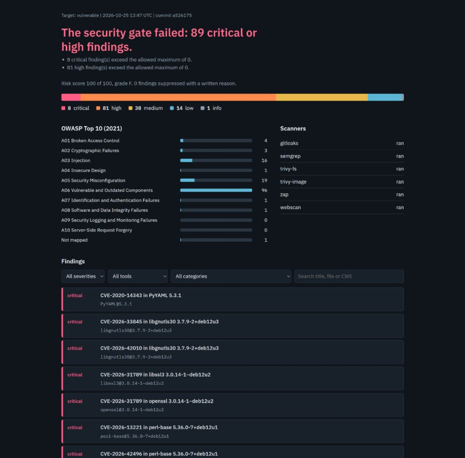
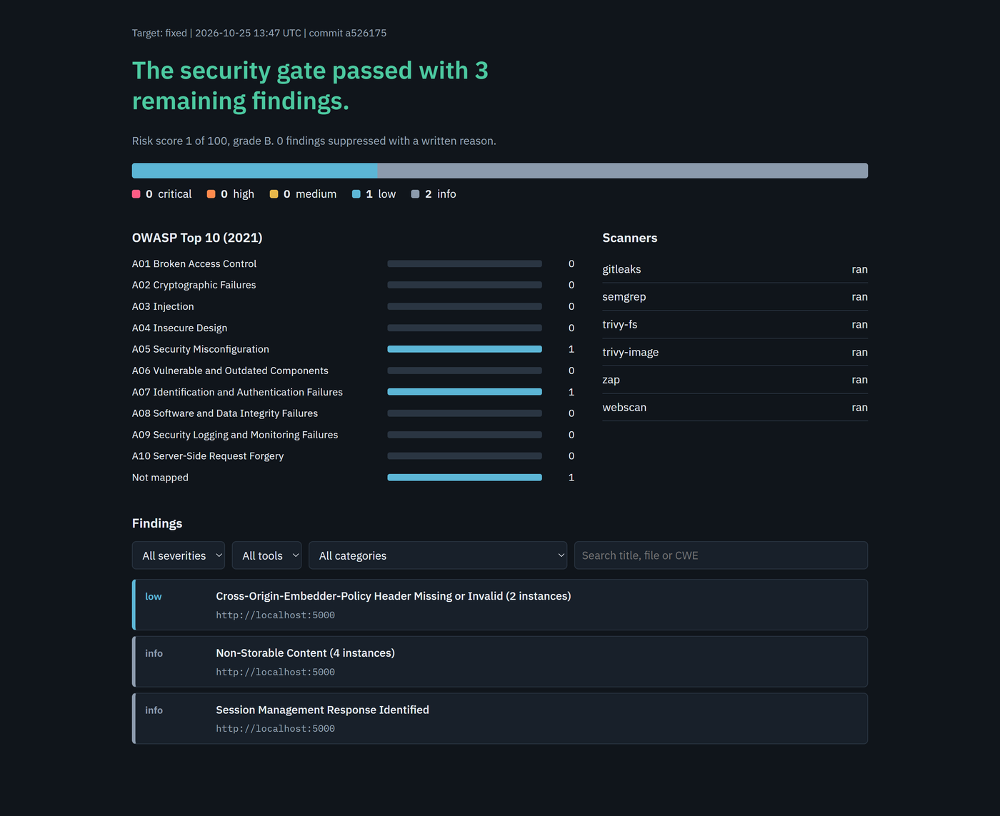
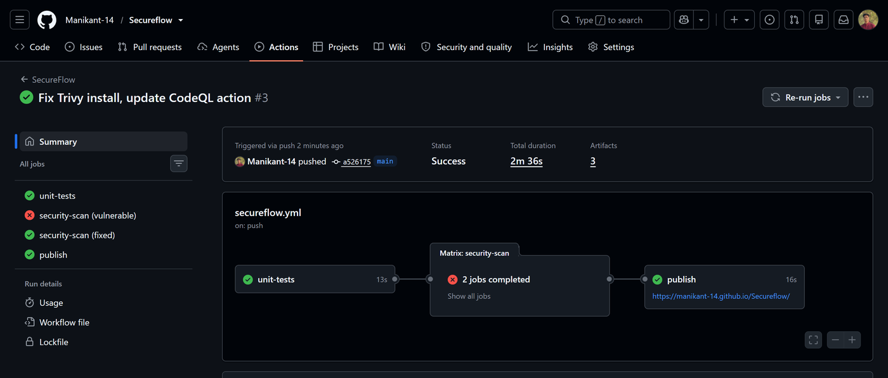

# 🛡️ SecureFlow
### Automated DevSecOps Security Pipeline — IBM Cybersecurity Bootcamp Project
**Built by Manikant | B.Tech CSE, Sharda University**

[](https://github.com/Manikant-14/Secureflow/actions/workflows/secureflow.yml)

**🔗 Live dashboard:** https://manikant-14.github.io/Secureflow/  




---

## 📌 Overview

SecureFlow is an automated **DevSecOps pipeline** that checks a web application for security flaws on every push. It runs six security checks, merges the results into one report mapped to the **OWASP Top 10**, and **fails the build** when critical or high-severity issues remain.

The repo contains two versions of the same Flask app: one **deliberately vulnerable**, one **hardened**. The pipeline blocks the first and passes the second, and a live dashboard shows the difference.

> ⚠️ `app/vulnerable` is dangerous on purpose. Never expose it to a network. The API key inside it is fake.

---

## 📊 Results

From the pipeline run on commit `a526175`:

| | Vulnerable app | Hardened app |
|---|---|---|
| Critical + high findings | **89** (8 critical, 81 high) | **0** |
| Total findings | 142 | 3 (1 low, 2 informational) |
| Risk score (0-100) | 100 (grade F) | 1 (grade B) |
| Security gate | ❌ Fails | ✅ Passes |

> 96 of the vulnerable app's 142 findings are vulnerable components (OWASP A06): its deliberately outdated libraries plus operating-system packages in the old `python:3.8` base image. The rest are the application flaws listed below.

| Hardened app dashboard | GitHub Actions run |
|---|---|
|  |  |

---

## 🏗️ How It Works

```
git push / pull request
        ↓
   GitHub Actions
        ↓
   Unit tests (pytest)
        ↓
   Security scan — runs on BOTH apps in parallel
   ┌──────────────────────────────────────────────────────┐
   │ Gitleaks     → hard-coded secrets                    │
   │ Semgrep      → insecure code (SAST)                  │
   │ Trivy fs     → vulnerable dependencies + Dockerfile  │
   │ Trivy image  → vulnerable OS packages                │
   │ OWASP ZAP    → web scan of the running app (DAST)    │
   │ Own scanner  → headers, CORS, cookies, exposed files │
   └──────────────────────────────────────────────────────┘
        ↓
   Aggregator: normalise → dedupe → map to OWASP → score
        ↓
   Security gate ── FAIL → build fails, report still published
        │
       PASS
        ↓
   Dashboard on GitHub Pages  +  findings in the GitHub Security tab
```

The aggregator **fails closed**: if a required scanner produces no output, the gate fails instead of silently passing. Secrets found by Gitleaks are never copied into reports.

---

## 🔍 What It Catches

| Flaw in the vulnerable app | OWASP 2021 | Found by | Fix in the hardened app |
|---|---|---|---|
| SQL injection, reflected XSS | A03 | Semgrep | Parameterised queries, auto-escaping |
| Command injection, unsafe YAML | A03 / A08 | Semgrep | Endpoint removed, `safe_load` |
| MD5 password hashing | A02 | Semgrep | `generate_password_hash` |
| Hard-coded API key | A07 | Gitleaks | Environment variables |
| Outdated libraries, old base image | A06 | Trivy | Upgraded versions |
| Container runs as root | A05 | Trivy | `USER appuser` |
| Missing headers, weak cookies, open CORS, exposed `.env` | A05 | ZAP + own scanner | Security headers, origin allow-list |
| Broken object-level authorisation (BOLA) | A01 | pytest | Ownership check |

---

## 🛠️ Tech Stack

GitHub Actions · Python · Flask · gunicorn · Docker · Gitleaks · Semgrep · Trivy · OWASP ZAP · pytest · GitHub Pages

---

## 🚀 Run It

**On GitHub (full pipeline)**
1. Fork or push this repo to GitHub.
2. **Settings → Pages → Source: GitHub Actions.**
3. Open the **Actions** tab. The `vulnerable` job is expected to be red; `fixed` should be green.

**Locally (VS Code)**
```bash
python -m venv venv
venv\Scripts\activate              # Mac/Linux: source venv/bin/activate
pip install -r requirements-dev.txt
pytest -q                          # 40 tests
```

---

## ⚙️ Configure the Gate

`policy/secureflow-policy.json`:
```json
{ "max_critical": 0, "max_high": 0, "max_medium": null,
  "required_tools": ["gitleaks", "semgrep", "trivy-fs", "trivy-image", "zap", "webscan"] }
```
Known findings can be accepted in `policy/suppressions.json`, but only with a written reason and an expiry date.

---

## 📁 Structure

```
app/vulnerable/   deliberately vulnerable Flask app + Dockerfile
app/fixed/        the same app, hardened
scanner/          custom web scanner
aggregator/       parsers, OWASP mapping, scoring, gate, SARIF, dashboard
policy/           gate thresholds and suppressions
tests/            40 pytest tests
.github/workflows/secureflow.yml   the pipeline
```

---

## 🔧 Troubleshooting

- **The hardened app fails on a new CVE:** new vulnerabilities appear over time. Bump the pinned version in `app/fixed/requirements.txt` or the Docker base image, or add a documented suppression.
- **Pages deploy fails:** check Settings → Pages → Source is **GitHub Actions**.
- **Alerts on `app/vulnerable` in Dependabot or code scanning:** expected, they are part of the demo.

---

## ⚖️ Ethics

Only scan systems you own or have written permission to test. The custom scanner refuses non-localhost targets unless you pass `--allow-remote`.

---

## 🔮 Next Steps

Pull request comments · trend chart per run · SBOM generation · Gitleaks pre-commit hook · ZAP full scan with authentication · LLM-assisted triage

---

## 👤 Author

**Manikant**
- GitHub: [github.com/Manikant-14](https://github.com/Manikant-14)
- LinkedIn: [linkedin.com/in/manikant14](https://linkedin.com/in/manikant14)
- Email: manikantmgr14@gmail.com

---

*Built for the IBM Cybersecurity Bootcamp project submission — October 2026*
